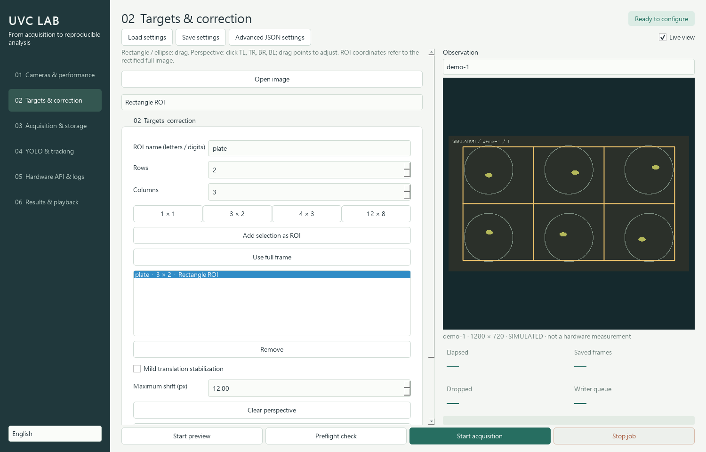

# UVC Lab — Camera Acquisition and Tracking

[English](README.md) | [繁體中文（台灣）](readme_TW.md)

**UVC Lab replaces the deprecated `yolo_tracker_GUI`.** It combines TrackBox UVC acquisition with zVision image-sequence analysis in one PyQt6 application. The interface supports Traditional Chinese (Taiwan), English, and Japanese.



## Windows: download and run

Download **`UVC-Lab-0.1.0-Windows-x64.exe`** from the [GitHub Release](https://github.com/LBK888/zVision/releases/tag/uvc-lab-v0.1.0). Run it directly; Python and a separate FFmpeg installation are not required.

The Windows x64 CPU build includes PyQt6, PyTorch, Ultralytics, FFmpeg, and default **YOLO26 segmentation and pose** weights. Custom models can be selected in the interface. For CUDA, run the source with the appropriate CUDA-enabled PyTorch installation.

The single-file EXE extracts its runtime to a temporary directory on startup. Allow time for startup and sufficient temporary disk space. Caches, downloaded models, logs, and default relative output folders live under **`%LOCALAPPDATA%\UVC Lab`**. Select another experiment output drive in the interface. This build is not code-signed; verify its SHA-256 against the release checksums.

## Run from source

From the zVision repository root:

```powershell
cd uvc_cam_pack
python -m venv .venv
.\.venv\Scripts\python.exe -m pip install -e '.[ai]'
.\.venv\Scripts\python.exe -m uvc_lab
```

Install FFmpeg and put it on `PATH` for source-based video recording and DirectShow mode enumeration. `install.ps1` installs Python dependencies; `start.bat` launches an existing environment. Python 3.12 or newer is recommended. Acquisition without AI can use `pip install -e .` without the `ai` extra.

Try the interface without hardware:

```powershell
.\.venv\Scripts\python.exe -m uvc_lab --demo
```

For the EXE, run `UVC-Lab-0.1.0-Windows-x64.exe --demo` or choose **Use simulated cameras**. Simulation is labeled and is never presented as a physical camera measurement.

## Workflow

1. **Cameras & performance:** find devices; read resolution, FPS, and transport formats; configure exposure, focus, and white balance. Benchmark individual cameras, then test the actual multi-camera storage and live-view configuration.
2. **Targets & correction:** drag rectangular or elliptical ROIs; choose 3×2, 4×3, or custom grids. For perspective correction, click top-left, top-right, bottom-right, bottom-left. Inspect the rectified full image before defining ROIs. Geometry can be saved per camera.
3. **Acquisition & storage:** select timelapse or continuous acquisition, interval, duration or unlimited operation, raw/processed images, and video. Run the space preflight check, then start acquisition.
4. **YOLO & tracking:** import an experiment folder or image sequence; add models, tasks, confidence thresholds, consensus mode, and tracker settings. Analysis is a separate offline job to protect capture throughput.
5. **Results & playback:** select a camera/target/ROI stream; seek or play frames and inspect objects. Change overlays and redraw videos from cached results without repeating inference, including reprojection onto uncropped originals.

Stop the preview job before formal acquisition. Live view can be toggled during acquisition. ROI editing is available during preview; the rectified snapshot pauses display for selection, and toggling Live view resumes it. Camera-control changes apply the next time the camera opens.

Analysis prefers processed images by default. To redefine ROIs, choose **Process from raw images** and uncheck **Reuse capture geometry**. Raw-only recordings replay the actual per-frame transforms recorded during acquisition.

## Features

| Area | Implementation |
|---|---|
| UVC and FPS | Windows DirectShow enumeration, Linux V4L2 support, explicit fallback subset probes, negotiated controls, and measured FPS |
| Cameras and targets | Independent capture threads; external-controller handshake for one moving camera |
| ROIs and plates | Multiple rectangles/ellipses, arbitrary m×n grids, full pixel coverage, per-camera geometry |
| Scientific controls | AE/AF/AWB, manual exposure/gain/focus/color temperature, scientific lock, set/readback evidence, strict validation |
| Corrections | Mild translation stabilization, four-point perspective, valid-pixel masks, recorded transforms |
| Scheduling | Monotonic timing, finite/unlimited duration, space estimates, low-space stop, bounded queues and drop records |
| Images/video | Raw + processed PNG/TIFF/JPEG; MP4 H.264 or AVI MJPEG; segments and timestamp-based CFR resampling |
| YOLO26 | Detect/segment/pose, custom weights, multiple models, class mappings, confidence and class filters |
| Consensus | Previous/current/next or original/CW/CCW 90°; object-level 2-of-3 voting with retained evidence |
| Tracking/exports | Corrected UKF/SORT/ByteTrack adapter; stream isolation; px/s velocity, mask area, pose, Excel and environmental charts |
| Reproducibility | Full settings JSON, manifests, package versions, model SHA-256, SQLite, source hashes, transforms, CLI |

The trackers adapt the original zVision implementations; this is not a claim of conformance to the official ByteTrack reference implementation.

## Profiles and model fusion

`profiles/` contains simulation, approximately 1MP/30 FPS video, 2MP/20 FPS video, and 8MP/10-minute timelapse starting profiles. **These are requested settings, not capability guarantees.** Adjust the device, mode, exposure, FPS, and output drive after measuring your hardware.

Configure custom segmentation and pose models inside the full settings' `analysis` section:

```json
{
  "models": [
    {"path": "animal-seg.pt", "task": "segment", "confidence": 0.3,
     "classes": [], "class_map": {"0": "animal"}},
    {"path": "animal-pose.pt", "task": "pose", "confidence": 0.3,
     "classes": [], "class_map": {"0": "animal"}}
  ]
}
```

Models process the same ROI in order. Semantic class and IoU matching associate their attributes with the same object. This is attribute fusion, not a segmentation-crop-to-pose cascade. Class mappings prevent unrelated model-local class IDs from being mixed. Official person-pose weights do not replace species-specific animal models.

Advanced JSON exposes fusion/consensus IoU, `class_similarity` such as `{"larva|pupa": 0.5}`, ByteTrack thresholds, trail length, overlay styling, and backend-specific exposure values. Unknown fields and invalid settings are rejected.

## ESP32, Raspberry Pi, or external PC

The application does not drive a motor. An external controller follows:

**`GET /v1/state` → move to target → `POST /v1/arrived` → wait for `capture_complete` → `POST /v1/acknowledge`.**

Completion remains latched until acknowledged. Move only when `can_move=true`. Capture uses fresh frames after settling; image and record completion precedes the completion signal.

See the [hardware API specification](docs/hardware-api.md) and [PC/Pi example](examples/controller_pc.py). A separate serial input accepts TrackBox temperature/humidity lines or JSON Lines and exports Excel charts.

## Output and headless operation

Each job creates an independent experiment directory:

```text
settings.json       Complete settings; API token redacted
manifest.json       State, versions, negotiated controls, statistics
records.sqlite      Frames, events, sensors, detections, tracks
models.json         Analysis model configuration and SHA-256
images/             Raw and processed capture images
masks/              Valid pixel regions
base/               Lossless analysis cache for redraw
videos/             Per-stream segments and encoder logs
report.xlsx         Frames, Detections, Tracks, Environment
```

```powershell
python -m uvc_lab --config profiles/demo.json --capture
python -m uvc_lab --config your-settings.json --analyze G:\experiment
```

Ctrl+C requests orderly shutdown in source CLI mode. Committed SQLite rows and finished video segments survive interruptions. Forced termination may leave partial files and an unfinished manifest.

Legacy `cam1_frame_<unix>.tiff` and `cam2_frame_<unix>.tiff` files can share a folder and become separate streams. Annotated duplicates are skipped when raw counterparts exist. Generic sequences use natural filename order and the configured capture interval, not filesystem creation times.

## Scientific and hardware boundaries

- No physical UVC camera was enumerated in the original validation environment. IMX179 throughput, actual controls, USB contention, arrival sensing, and long-duration stability need target-hardware validation.
- Finite benchmarks measure the current resolution, format, exposure, computer, and load; they do not guarantee a permanent maximum FPS. Multi-camera capture is software-coordinated, not hardware-synchronized exposure.
- **Raw means decoded, untransformed BGR8 output**, not sensor Bayer RAW. PNG/TIFF preserve that decoded image losslessly; JPEG is lossy. Generic UVC cannot add missing autofocus hardware, universal black-level calibration, or vendor-specific native 16-bit support.
- 2-of-3 consensus can increase false negatives, especially after rotating upright-trained models or with long capture intervals. Validate precision/recall using labeled experimental data. Neighbor-only temporal positives do not receive fabricated center-frame area or pose.
- `area_px2` uses the processed tile grid. Calibrate `pixel_size_um` on the corrected image plane before reporting physical area.

See the [design report](docs/analysis-design.md) and [validation record](docs/validation.md). These technical documents currently use Traditional Chinese; API/data identifiers remain stable across interface languages.

## Development and packaging

```powershell
python -m pip install -e '.[ai,test]'
python -m pytest -q
python tools/smoke_yolo.py --consensus none
python tools/smoke_yolo.py --consensus temporal
python tools/smoke_yolo.py --consensus rotation
```

Source smoke tests download official weights on first use. The EXE includes the default segmentation/pose weights. See [Windows build instructions](packaging/README.md) and [third-party provenance](THIRD_PARTY.md).
