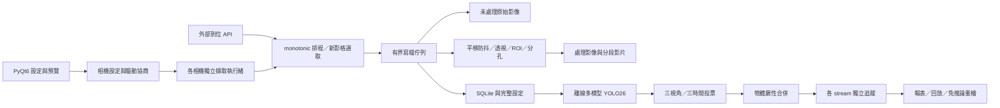

# 程式分析、重構與科學量測設計

## 檢查範圍

本次讀取與分析的固定版本：

- [TrackBox/TrackBox_recodring](https://github.com/LBK888/TrackBox/tree/f5fbf652e63349fd2edeb9331293fe0bb72773f4/TrackBox_recodring)：AVI 錄影、IMX179 參數設定、溫溼度序列埠、多相機照片、分孔 segmentation、面積與 Excel。
- [zVision/yolo_tracker_GUI](https://github.com/LBK888/zVision/tree/cf58cf4a6b77f35a624219544b1a60394c04dcf8/yolo_tracker_GUI)：PyQt5 分析介面、多模型、ROI、UKF／SORT／ByteTrack、軌跡疊圖、結果快取重繪、影片與 Excel。

透過 codebase-memory-mcp 建立兩個專案索引，按函式與呼叫關係檢查。新程式使用 PyQt6，並保留原追蹤器的適配版本；原始上游快照位於本機 `upstream/`，執行時不依賴它們。

## 原演算法與可確認的缺失

| 位置 | 原行為與問題 | 整合版處理 |
|---|---|---|
| `IMX179_recording_AVI.py / capture_frames` | 128 張佇列滿時直接跳過，沒有序號、時間戳與掉幀紀錄 | 依記憶體預算建立有界佇列；預設滿載停止並記錄，另可明確選 drop 政策 |
| `VideoRecorder.record` | 設定影片播放 fps，與實際擷取率沒有時間基準連動，可能使影片速度不符實際時間 | 連續模式按 monotonic 擷取時間重取樣為指定 CFR；重複與略過張數均保留 |
| `record / read_temp_humid` | 同一寫檔迴圈讀序列埠，讀取 timeout 可能拖慢寫影片；持續讀取與顯示也會增加負載 | 相機、寫檔、環境資料各自執行；UI 使用有界最新畫面信箱 |
| `record` 的異常路徑 | 資源收尾分散；部分錯誤可能來不及關閉影片或排空佇列 | 統一停止擷取、排空寫檔、完成影片、更新 manifest；未完成片段有 partial 名稱 |
| `set_auto_exposure` | 以影像灰階分布迭代尋找「好看」曝光，不等同相機自動曝光；可能改變生物亮度數據 | 相機 auto 與科學固定參數分開；不依亮暗自行美化原始資料 |
| 固定 IMX179 常數 | 硬編碼解析度與預期 fps，沒有實測當前電腦與 USB 負載 | 列舉驅動宣告模式、驗證實際協商值；獨立相機與完整系統兩種測試 |
| `IMX179_recording_multiLTTL.py / main` | 同一迴圈依序開相機、等待穩定、分孔推論、寫 Excel 後才拍下一台 | 相機持續各自擷取；共用排程 deadline，實際拍攝時間差寫入紀錄；分析移到離線工作 |
| 同上 | 用 wall clock 排程；每週期重新開機可能使 AE／AF 每次重新收斂 | monotonic 排程；相機保留開啟，實際控制回報另記 |
| 同上 | 每次把完整 Excel 讀入、concat 再重寫；資料越長越慢，且中斷可能損壞整份報表 | SQLite WAL 持續追加，結束或需要時串流匯出 Excel |
| `split_frame` | 整除後的右／下邊界餘數像素會遺失 | 整數邊界等分，所有像素完整涵蓋 |
| segmentation 面積 | 用輪廓多邊形與 buffer 修補估面積，與實際 mask 像素面積不一定相同 | 在輸出影像像素網格計算二元 mask 面積，保留可還原的壓縮 mask；面積單位明列 |
| `ProcessThread.create_analyzed_video` | 把 crop offset 加入偵測框後，送進裁切影像 renderer，座標可能偏移 | 推論與疊圖一律用 tile 座標；另外保存 sensor→tile 矩陣與 sensor 四角 |
| 同上 | 多模型 detections 直接 extend 成一串，seg 與 pose 可能把同一物體當兩個物體 | 每模型保留自身語意，依共同類別與 IoU 一對一合併物體屬性，再進追蹤 |
| 同上 | 追蹤 update 未傳影像實際時間差，速度預設是每張而非每秒 | 使用時間戳 dt，速度輸出 px/s；不同相機／目標／ROI 各自一個 tracker |
| 原 UKF `generate_sigma_points` | Cholesky 下三角矩陣取 row；sigma points 無法重建原共變異數 | 改取 column；用具有非零交叉共變異數的回歸測試驗證 |
| 原 SORT `predict_tracks` | 接收 dt 卻沒有用它更新 F，ByteTrack 也繼承此問題 | 每次以真實秒數更新位置與面積速度的狀態轉移 |
| 原 matching | 先 Hungarian 再閾值排除，無效配對可能佔用原本可用的候選 | 在指派前先把不可用邊設為高成本 |
| 原 `get_confirmed_tracks` | 可能回傳目前沒有量測、只靠預測延伸的 confirmed tracks | 可維持內部追蹤，但本張的正例與科學量測只輸出有觀測更新者 |
| 原分析快取 | frame_cache、all_detections、tracking_history 隨序列無限成長 | 影像使用三張滾動視窗，偵測／軌跡寫 SQLite，歷史記憶體有界 |

UKF 回歸範例：輸入共變異數 `[[2,1],[1,3]]`，原實作還原約 `[[2.5,1.118],[1.118,2.5]]`；修正後在 `1e-4` tolerance 通過。這是程式數學錯誤，與實際相機資料無關，可直接重現。原 UKF 的狀態轉移本身是恆速模型；使用 UKF 不會自動使運動模型變成非線性或增加追蹤準確度。

## 新的執行模型

拍攝預覽可在執行中切換。預覽關閉時不做縮圖、畫面訊號或 UI 繪製；檔案輸出與必要校正仍照設定執行。AI 分析採獨立離線工作，避免 GPU／CPU 推論拖慢資料擷取。現階段同一視窗一次執行一個正式工作。

多相機是並行擷取與共用軟體時間基準，**不是硬體同步曝光**。每週期保存各台真實 host timestamp 與 skew；USB UVC 通常沒有可由這套通用介面存取的 sensor trigger／硬體時間戳。

## 能力列舉與 FPS

Windows 優先用 `cv2-enumerate-cameras` 取得名稱、索引與 device path，模式由 FFmpeg DirectShow `-list_options true` 取得；Linux 可用 `v4l2-ctl --list-formats-ext`。缺少完整列舉工具時，才讀回驗證候選解析度，明列為「部分 probe 結果」。不把常見 IMX179 規格假裝成每台相機保證支援的清單。

單機 8 秒測試會先 warmup，再量 read completion 平均 FPS、95 百分位讀取間隔與保守 FPS。這是選定解析度／傳輸格式／曝光下的實測吞吐量，不能保證一個未來長時間工作的絕對最高值。

系統實測讓所有選定相機同時連續擷取 8 秒，使用目前 raw、processed、影片與 live 設定寫實際檔案。輸出 capture FPS、saved、writer capacity、佇列、掉幀與建議 FPS（含 10% 餘裕）。若佇列滿或磁碟太慢，預設停止，測試本身也會留下可分析的實驗目錄。

需要最高 FPS 時，從驅動宣告的最高 rate 測試，再按實測建議調低要求與影片 FPS。共享 USB hub、曝光時間、CPU 解碼、影像格式、磁碟與同時開啟的其他軟體都會改變結果；長時間實驗前應做符合真實儲存設定的較長驗收。

## 2/3 投票的定義與限制

每個模型獨立投票，匹配條件為相同共同語意類別與 IoU 閾值，採一對一配對。同一張圖中兩個同類物體不能互相當作兩票，重複框也不能增加票數。

- 時間模式：使用前一張、本張、後一張；首尾缺少的鄰張不補成自己的複本。需要下一張，所以至少延遲一張輸出。若只有前後張支持，標記 `inferred=true` 與 `observed_in_center=false`，不填本張 mask／面積／pose。
- 旋轉模式：原圖、CW 90°、CCW 90°。框、mask、關鍵點必須先逆轉回同一座標再投票；非正方形影像也有測試。只有旋轉視圖支持時，記錄量測來源為 `rotated_views_same_time`。
- 低於模型 confidence 的候選可以供 ByteTrack 恢復舊軌跡，但標記 `positive=false`，不作為正例投票或在畫面上顯示為正例。
- 所有視圖的原始候選包含在 `metadata.model_evidence`，被投票否決的框也能事後稽核。

此策略**不保證降低整體錯誤率**。三次輸入高度相關；相同誤判可能三次都出現。旋轉會改變模型訓練分布；本次官方 bus 範例在原圖有偵測，320px 的 ±90° 視圖卻都無偵測，因而全部被投票排除。時間間隔很長、快速運動、物體短暫出現或遮擋，也容易使 IoU 配對失敗。應使用具有真值的實驗資料，同時報告 precision、recall、每類別結果與跨目標／相機差異，再決定 confidence、IoU 與模式。

## 多模型、mask 與量測單位

官方 [YOLO26 文件](https://docs.ultralytics.com/models/yolo26/) 確認 detection、segmentation、pose 等任務。程式直接使用已驗證可載入的 `yolo26n-seg.pt`、`yolo26n-pose.pt` API；也支援指定自訓模型檔案。模型順序在 UI 清單設定，預設把 segmentation 作為主要物體框，再合併 pose。

各模型先分析同一張完整 ROI，再以類別與 IoU 合併；這是同圖序列執行與屬性融合，**不是將 segmentation 的裁切物件餵給下一個 pose 模型的 cascade**。多模型 class ID 不能直接共用；自訂模型可用 `class_map` 明確映射到共同標籤。官方 person pose 不會自動適用於昆蟲或其他生物。

遮罩面積採 ROI 有效範圍內的二元 mask 像素數；橢圓外與校正無效邊界不計入。完整 mask 以 zlib 壓縮 packbits 存在 detection payload，`decode_mask()` 可還原。輪廓僅用於疊圖／原圖重繪，不用來替代像素面積。

`area_px2` 是校正後 tile 的像素面積。可設定校正後平面上的 `pixel_size_um`，得到 `area_um2 = area_px2 × pixel_size_um²`；未標定不產生物理面積。不同光學配置／透視輸出尺寸需要重新標定。

## 實驗可重現性

每次實驗的 `settings.json` 包含所有可設定參數，API token 例外以 `<redacted>` 遮蔽；重新載入這種設定會產生新 token，不影響科學參數。個人儲存的 preset 可保留 token。

`manifest.json` 包含 Python／套件版本、OpenCV build、FFmpeg 版本、狀態、統計與驅動協商結果。YOLO 分析另有 `models.json`，記錄模型路徑、SHA-256、任務、類別、confidence、映射與其他設定。影像分析會保留來源路徑、hash、時間基準、轉換矩陣、原始候選與最終量測。

UVC raw 在此指**解碼後、未裁切／校正的 BGR8 影像**；不是感光元件 Bayer RAW，也無法還原相機內部 ISP／MJPEG 編碼已失去的資訊。PNG／TIFF 可無損保存這份解碼影像；JPEG 本身仍是有損格式。

固定參數模式不做亮度正規化、直方圖拉伸或自動改善過暗／過亮。硬體仍可能不支援曝光、focus、WB 或 gain 的通用控制：保存 set 成功與 readback 差異，並可選「設定無法驗證時停止」。readback 相符代表驅動回報相符，不能當作相機電子實作已經過外部量測認證。通用 UVC 沒有所有科學相機都共用的「自動黑電平校準」或原生 16-bit sensor RAW 接口，這類功能需相機 extension unit／廠商 SDK。

## UX 決策

主流程六頁：相機與效能 → 目標與校正 → 拍攝與儲存 → YOLO 與追蹤 → 硬體 API／紀錄 → 結果回放。預覽固定在右側，不需在設定分頁之間尋找畫面。

常用選項有原生控制項；完整 JSON 可設定少用參數（每台相機幾何覆寫、class_map／class_similarity、ByteTrack 閾值、overlay 色彩、原生 AE 控制值等）。套用時驗證欄位、數值、範圍與 schema，不接受拼錯參數悄悄失效。正式工作進行中鎖定設定，live 仍可切換。

繁中、英文、日文介面字串集中於 `i18n.py`，工作資料欄位與 API 使用固定識別字，方便跨語言研究團隊交換設定和程式分析。
