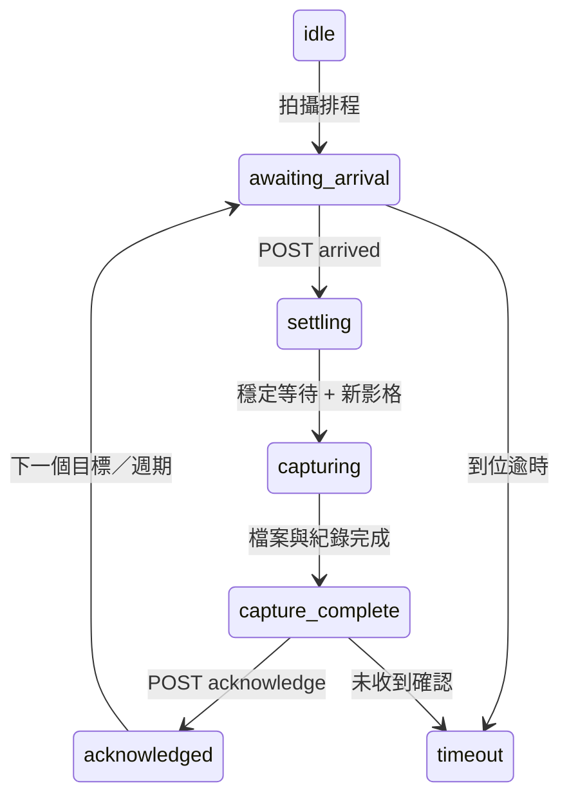

# 外部移動相機 API v1

相機由本程式擷取；ESP32、Raspberry Pi 或另一台 PC 自行控制馬達。本程式不發送馬達驅動指令。

在「硬體 API 與紀錄」啟用握手，設定一台相機、定時照片模式、目標順序、到位後穩定秒數與 timeout。API 隨正式拍攝啟動；單純預覽不啟動 API。多台固定相機可以各自同時擷取；移動模式是單台相機依序拍不同目標。

預設綁定 `127.0.0.1:8765`。外部控制器連線時改成拍攝電腦的區網 IP，控制器填同一個位址。每個要求包含：

```http
Authorization: Bearer <介面中設定的 token>
Content-Type: application/json
```

HTTP 適用可信任的實驗室區網；跨不可信任網路時應由你既有的 HTTPS 反向代理或 VPN 提供傳輸保護。

## 流程

1. 控制器 `GET /v1/state`。
2. `phase=awaiting_arrival`、`can_move=true` 時，讀取 `target` 與新的 `request_id`，控制器自行移動到該位置。
3. 確認硬體實際到位後 `POST /v1/arrived`。
4. 程式回到 `settling`，`can_move=false`；穩定等待後，再排除 `flush_frames` 張舊影格，使用到位後的新影像。
5. `capturing` 期間不可移動。原始／處理影像與 SQLite 紀錄保存完成；如有影片，該目標的片段也會關閉完成。
6. `capture_complete`、`can_move=true`，`capture` 含完成結果。控制器 `POST /v1/acknowledge`，確認已收到。
7. 程式才會要求下一個目標。即使控制器輪詢較慢，也不會因為瞬間切換狀態漏掉完成通知。



`can_move=true` 是程式已不需要目前畫面保持靜止；請只依新的 `awaiting_arrival.target` 啟動下一次定位。`acknowledged` 的 target 仍是剛拍完的目標。

## API

`GET /v1/state` 範例：

```json
{
  "phase": "awaiting_arrival",
  "request_id": "每次新的 32 字元 request ID",
  "target": "A1",
  "can_move": true,
  "revision": 3,
  "capture": null,
  "events": []
}
```

`POST /v1/arrived` 與 `POST /v1/acknowledge` 使用相同格式：

```json
{"request_id": "目前的 request ID", "target": "A1"}
```

成功回應 `200` 與目前狀態。token 錯誤 `401`；舊 ID、錯誤目標或不正確階段 `409`；未知路徑 `404`。同一個有效到位要求重送不會重設穩定計時；同一個完成確認重送也不會觸發第二次拍攝。進入下一個 request 後，上一個 request 會被拒絕。

`events` 最多保留最近 256 個狀態，可依 revision 補讀。完整歷史另存於實驗 SQLite 的 `events` 表；API 不會任意丟棄完成訊號來切下一個目標。

`capture`：

```json
{
  "request_id": "...",
  "camera": "camera-0",
  "sequence": 42,
  "unix_s": 1790000000.123456,
  "files": ["images/camera-0/A1/raw/....png", "images/camera-0/A1/plate/....png"]
}
```

`files` 是實驗目錄內的影像相對路徑。影片另依 stream 儲存在 `videos/`。序號來自擷取影格，不要求連續；定時照片會跳過未被排程保存的影格。

## 控制器範例

PC／Pi：執行 `examples/controller_pc.py`，將 `move_and_wait()` 接到現有控制程式。`--simulate` 只用於測試握手，不代表真實硬體到位。

ESP32 可使用 Arduino `HTTPClient` + ArduinoJson 或 MicroPython `requests`，實作同樣三個端點；必須把真正的限位／編碼器／到位確認接在 `POST arrived` 前。請勿以收到 HTTP 成功回應當作馬達實際到位。

## 溫溼度

這是獨立序列埠輸入，不與馬達控制共用連線。支援原 TrackBox 格式：

```text
Temperature: 23.4 C, Humidity: 60.0 %
```

以及 JSON Lines：

```json
{"temperature": 23.4, "humidity": 60.0}
```

預設 115200 baud、每 5 秒存一筆、開始時送 `START\n`，可在進階 JSON 調整。原始行、UTC 時間、溫度 °C、濕度 % 都會保存，結束時匯出 Excel 與折線圖。序列埠故障會留下事件，影像拍攝仍可繼續。
