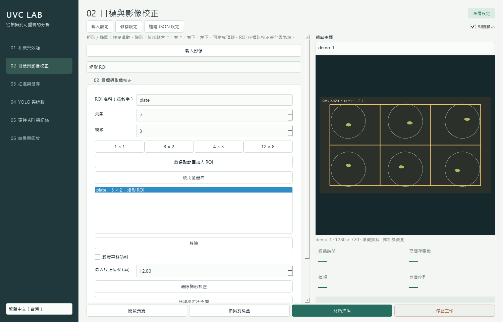

# UVC Lab

[English](README.md) | [繁體中文（台灣）](readme_TW.md)

**本程式取代已 deprecated 的 `yolo_tracker_GUI`。新的攝影與追蹤工作請使用 UVC Lab。**

把 TrackBox 擷取與 zVision 照片序列分析整合為一套 **PyQt6 科學影像工作站**。包含繁體中文（台灣）、英文、日本語介面，可用 GUI 或無 UI 模式執行。



## 直接啟動

Windows 使用者可從 [GitHub Release](https://github.com/LBK888/zVision/releases/tag/uvc-lab-v0.1.0) 下載 **`UVC-Lab-0.1.0-Windows-x64.exe`**，直接執行，不需另外安裝 Python 或 FFmpeg。單檔 CPU 版內含預設 YOLO26 segmentation／pose 權重；自訓模型可在介面選取。需要 CUDA 時請使用原始碼與對應的 CUDA PyTorch。

EXE 啟動時會解壓執行環境到暫存目錄，請保留足夠暫存空間並等待啟動。快取、日誌與預設相對輸出目錄位於 `%LOCALAPPDATA%\UVC Lab`；實驗影像可另選硬碟。此版本未做程式碼簽章，可對照 Release 的 SHA-256 檢查下載完整性。

使用原始碼時，先進入 `uvc_cam_pack` 資料夾並執行 `install.ps1`，再雙擊 **`start.bat`**。

先看模擬相機、不需接硬體：

```powershell
.\.venv\Scripts\python.exe -m uvc_lab --demo
```

其他電腦建議使用 Python 3.12 或更新、FFmpeg（需在 PATH）：

```powershell
.\install.ps1
```

或自行建立虛擬環境後執行 `python -m pip install -e '.[ai]'`。純擷取不需安裝 AI extra。CPU 可執行 YOLO；CUDA 版 PyTorch 依該電腦的 GPU／驅動另外安裝。本機以 Python 3.14.3、PyQt6 6.11 與 Ultralytics 8.4.45 測試。

## 建議操作順序

1. **相機與效能**：搜尋 UVC 裝置，讀取解析度／FPS／傳輸格式，設定曝光、焦點、白平衡。先單機實測，再依真正要使用的 raw／processed／video／live 設定做系統實測。
2. **目標與影像校正**：開啟預覽，在畫面上拖曳矩形／橢圓；選 3×2、4×3 或自訂列欄，再加入 ROI。四點模式依左上→右上→右下→左下選梯形；先檢視校正後全圖，再在該座標設定 ROI。可為每台相機保存不同幾何設定。
3. **拍攝與儲存**：選定時照片或連續擷取、間隔、總長度或無限長，選 raw／processed／影片。執行拍攝前檢查，看空間與預估可拍時間，再開始拍攝。
4. **YOLO 與追蹤**：選擇剛拍的實驗資料夾或既有照片序列，加入模型與任務、confidence、投票與 tracker，再執行分析。AI 離線執行，擷取時可保持最高可用吞吐量。
5. **結果與回放**：選 stream，拖曳時間軸、播放、滑鼠檢視物體；調整 bbox／mask／pose／trail／velocity／時間標示，免重新推論重製影片，也可重投影到未裁切原圖。

開始預覽後，先按「停止工作」關閉預覽工作，再開始正式拍攝。正式拍攝期間右上「即時顯示」可隨時開關；關閉時停止縮圖與畫面更新。進行中設定鎖定，避免實驗中途被改寫。

預覽工作允許編輯 ROI；「檢視校正後全圖」會固定目前的校正畫面供選取，切換「即時顯示」可恢復更新。曝光等相機參數在下次開啟相機時套用。分析既有實驗時，預設優先使用 processed；若要改 ROI，選「從原始影像處理」並取消「沿用拍攝時幾何設定」。若只保存 raw，預設會以每張紀錄的實際轉換矩陣還原原先 ROI。

## 已整合功能

| 項目 | 實作 |
|---|---|
| UVC 與 FPS | Windows DirectShow 列舉、實際協商回報、單相機實測、所有相機同時寫檔測試；Linux 可用 V4L2；缺少列舉工具時標示部分驗證結果 |
| 多相機／移動目標 | 每相機獨立擷取；單相機多目標由外部控制器透過 HTTP 到位／完成確認握手 |
| ROI／多孔盤 | 多個矩形或橢圓 ROI，每 ROI 自訂 m×n 等分，邊界不遺失像素；每台相機可覆寫 |
| 科學相機控制 | AE／AF／AWB 與手動曝光、gain、focus、色溫；固定參數模式；set／readback 紀錄與嚴格驗證選項 |
| 軟體校正 | 固定參考影像的輕度平移防抖、四點透視、有效像素 mask、完整座標矩陣 |
| 排程與空間 | monotonic 定時、無限長或指定時間、保守空間估算、低空間自動停止、佇列滿載政策與掉幀紀錄 |
| 影像與影片 | 未處理 raw + processed；PNG／TIFF／JPEG；MP4 H.264 CRF 與 AVI MJPEG；影片分段與 CFR 重取樣統計 |
| YOLO26 | detect／segment／pose、自訓模型、多模型同圖屬性融合、confidence／類別篩選與語意映射 |
| 複雜分析 | 前／本／後張 2/3 與 ±90° 2/3；同類且同物體一對一投票，原始候選保留供稽核 |
| 追蹤與報表 | 修正後的 UKF／SORT／ByteTrack 適配版；每 stream 隔離；速度 px/s、mask 面積、pose、Excel 與環境折線圖 |
| 研究紀錄 | 設定 JSON、manifest、軟體／驅動／模型 SHA-256、SQLite、來源 hash、轉換與量測證據；支援無 UI CLI |

## 常用設定檔

`profiles/` 有模擬、約 1MP／30 FPS、2MP／20 FPS 影片、最高解析度每 10 分鐘一張的起始設定。它們是**設定範例，並非相機能力保證**；先以實際驅動模式與效能測試結果調整 source、解析度、FPS、曝光與輸出磁碟。

多模型自訓範例：

```json
{
  "models": [
    {"path": "animal-seg.pt", "task": "segment", "confidence": 0.3,
     "classes": [], "class_map": {"0": "animal"}},
    {"path": "animal-pose.pt", "task": "pose", "confidence": 0.3,
     "classes": [], "class_map": {"0": "animal"}}
  ]
}
```

將這個片段放在完整設定的 `analysis` 內。進階 JSON 保留其餘欄位，包含 `fusion_iou`、`consensus_iou`、`class_similarity`（例如 `{"larva|pupa": 0.5}`）、ByteTrack high／low threshold、軌跡長度、顏色與相機原生 AE 數值。官方 pose 預訓練模型針對 person，其他物種需要相應的自訓模型。

## 外部 ESP32／Pi／PC

使用 **`GET /v1/state` → `POST /v1/arrived` → 等待 capture_complete → `POST /v1/acknowledge`**。程式保存完成後才允許移動，不控制馬達。

完整格式、重試、token、timeout 與溫溼度格式見 [硬體 API 文件](docs/hardware-api.md)。PC／Pi 範例在 `examples/controller_pc.py`。

## 輸出與無 UI 使用

每次工作建立獨立、避免覆寫的實驗目錄：

```text
settings.json        所有實驗設定；API token 遮蔽
manifest.json        執行狀態、版本、協商結果與統計
records.sqlite       frames / events / sensors；分析包含 detections / tracks
models.json          分析的模型資訊與 SHA-256
images/              capture raw 與處理後 ROI
masks/               ROI 有效像素範圍
base/                分析結果的無損影像快取，可免推論重繪
videos/              分 stream、分段影片與 encoder log
report.xlsx          Frames / Detections / Tracks / Environment
```

擷取：`python -m uvc_lab --config profiles/demo.json --capture`。

離線分析：`python -m uvc_lab --config your-settings.json --analyze G:\experiment`。

Ctrl+C 可要求停止與檔案收尾。異常時看 manifest 與 events；SQLite 已提交的紀錄與完成的影片片段仍可讀。若程序被強制終止，partial 影片可能未完成，manifest 可能維持 running；不會謊稱該工作已成功。

舊 TrackBox 的 `cam1_frame_<unix>.tiff`、`cam2_frame_<unix>.tiff` 可放同資料夾匯入，會拆為不同 stream；有 raw 時略過同名 annotated 副本。一般序列依自然檔名排序，時間來源為設定的每張間隔；不把檔案建立時間當作實驗時間。

## 已知邊界與驗收

本機目前未列舉到 UVC 裝置，**未宣稱完成 IMX179／實際 USB 頻寬／實體馬達驗收**。已完成模擬多相機擷取、真實 HTTP 握手、真實 YOLO26 segmentation + pose、MP4／AVI、三語介面與自動化測試。詳見 [驗證紀錄](docs/validation.md)。

2/3 投票可能降低誤判，也可能大幅增加漏判，尤其模型不熟悉旋轉或照片間隔很長時。沒有實驗真值前不能宣稱其效果一定更好。

這裡的 raw 是相機輸出解碼後的 **BGR8 未處理影像**，不是 Bayer sensor RAW。通用 UVC 無法保證每台相機都有 AE／AF／AWB、黑電平校準或原生 16-bit 控制；驅動回報不符會紀錄，選嚴格模式可停止。多相機為軟體並行，沒有硬體曝光同步。遇到完全卡住的相機驅動會回報需重新啟動，不會把該次工作標成成功。

詳細問題證據、演算法取捨與設計見 [分析與設計報告](docs/analysis-design.md)。

## 開發與測試

```powershell
python -m pip install -e '.[ai,test]'
python -m pytest -q
python tools/smoke_yolo.py --consensus none
python tools/smoke_yolo.py --consensus temporal
python tools/smoke_yolo.py --consensus rotation
```

smoke 測試第一次會下載官方模型權重；正式實驗可先準備模型以離線執行。套件與原始碼授權來源見 [THIRD_PARTY.md](THIRD_PARTY.md)。
